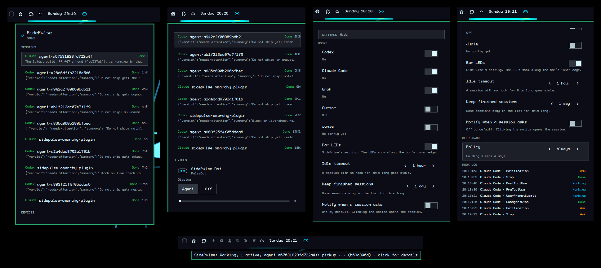

# SidePulse for Omarchy

[](https://github.com/mattiasbrandt/sidepulse-omarchy-plugin/actions/workflows/ci.yml)
[](https://github.com/mattiasbrandt/sidepulse-omarchy-plugin/releases/latest)
[](LICENSE)

An Omarchy bar widget for SidePulse devices and AI coding agents. It shows your
agents' State in the bar (Working, Ask, Done or Idle), lights a SidePulse Dot or
SidePulse Pro to match, and holds the settings in a popup, the way the macOS
SidePulse menu-bar app does.

> **Unofficial hobby project.** This plugin is a personal contribution to the
> Omarchy community. It is not made by, affiliated with or endorsed by the SidePulse
> project. [SidePulse](https://sidepulse.io) and its
> [software](https://github.com/inteliwear/sidepulse) are the work of Peter Kuhar
> and the SidePulse contributors, and all credit for the product goes to them.
> Please report problems with this plugin
> [here](https://github.com/mattiasbrandt/sidepulse-omarchy-plugin/issues), not to
> the SidePulse project.



> **Status:** early release. Tested on Omarchy 4.0.4 with a SidePulse Dot.
> **SidePulse Pro is untested on hardware.** If you have one, please report what
> works.

## Install

1. Install SidePulse first, with its own installer. Its setup instructions are at
   [sidepulse.io](https://sidepulse.io/setup). On Linux, use the Installation
   section of upstream's README at the commit this plugin is tested against,
   [inteliwear/sidepulse at 20ca7fd](https://github.com/inteliwear/sidepulse/blob/20ca7fdd6645ba070af607e24587084b6f809275/README.md#installation).
   SidePulse's installer installs hooks for every agent it supports; turn off the
   ones you do not want in the popup's Settings.

2. Add the plugin. Run this in a terminal, because it asks questions:

   ```sh
   omarchy plugin add https://github.com/mattiasbrandt/sidepulse-omarchy-plugin
   ```

   It asks you to confirm the plugin (plugins run unsandboxed inside the shell,
   see [Security](#security)), whether to enable it now, and which bar section to
   put it in (`right` by default). Do not add `--yes`: it skips the section
   prompt without saying so. If the command reports `Added` but the widget is not
   enabled, enable it yourself, with `left`, `center` or `right`:

   ```sh
   omarchy plugin enable io.github.mattiasbrandt.sidepulse --section right
   ```

3. Restart the shell, so it loads the plugin's helper:

   ```sh
   omarchy restart shell
   ```

4. Click the SidePulse icon in the bar. The popup's Setup section lists what is
   still missing: SidePulse itself, a stopped background service (Start service
   starts it), or a device to plug in.

To update, run `omarchy plugin update io.github.mattiasbrandt.sidepulse`, then
`omarchy restart shell` again. A shell that keeps its old copy of the plugin runs
the old helper.

## Usage

Click the SidePulse icon to open the popup. The keys are the ones the other
Omarchy popups use: `j` and `k` (or the arrow keys) move the highlight, `h` and
`l` change the highlighted setting, Enter or Space runs the highlighted row, Tab
moves to the next open bar popup, `r` refreshes, and Esc or a click outside
closes the popup.

The bar icon's colour follows the agents' State, and its tooltip ends in
`· click for details`. A left click is the only mouse action.

**Sessions** lists up to ten recent agent sessions, in SidePulse's order: the most
urgent first. A finished session whose folder no longer exists (a deleted worktree or
checkout) is left out, since it cannot be resumed. **Keep finished sessions** in
Settings sets how long Done sessions stay, within what SidePulse's service keeps:
its service forgets a finished session after 20 minutes, so a longer setting shows
no more, as in SidePulse's own menu. Enter or a click on a session:

- a running session focuses its window. If it runs inside herdr or tmux, the
  popup focuses its pane, and opens a terminal attached to the multiplexer when
  none is open;
- a stopped session resumes in a new terminal (your default, through
  `xdg-terminal-exec`), in its own folder;
- when SidePulse cannot tell which process runs a session, the popup says where it
  may be running and does nothing. That covers Codex, Cursor and Junie sessions in
  a folder where an agent process is running, because resuming one could start a
  duplicate of a live session.

**Devices** lists each connected SidePulse Dot or SidePulse Pro with its Display
and brightness. Its LEDs show what its program plays. A Display is one of:

- **Agent**: the device shows the agents' State (the default);
- **Battery**: the battery level, offered only on a laptop with a battery;
- **Off**: the device stays dark.

A SidePulse Pro that unmounts on suspend shows as not connected until it mounts
again. The popup does not prevent ejection.

**Bar LEDs** (in Settings) are the Omarchy counterpart of the SidePulse Notch in the
macOS app. They draw the State's LEDs along the inner edge of the bar:
2 LEDs for a SidePulse Dot and 8 for a SidePulse Pro. They appear on every monitor
and on a top, bottom, left or right bar. They need `wasmtime`, see
[Requirements](#requirements).

**Keep awake** (in Settings, Policy) keeps the machine from sleeping on lid close,
as its policy says. It has three policies: **Never**, **When Agents Work** (the
default, so the lock is held while an agent works) and **Always**. It holds a
sleep lock only: the screen can still lock, and no idle setting is changed. When the battery falls below 20 % while the
machine is unplugged, Keep awake lets go. The popup then sends a desktop notice,
`Keep awake paused by the battery safeguard: 19 %, unplugged`, and a second one,
`Keep awake resumed: plugged in`, when it holds again. The **Battery safeguard**
is that threshold, 20 % by default, in SidePulse's settings. Policy Never sends no
notices, and neither does a Battery safeguard that blocks nothing (no agent
working). Its notices are covered by unit tests; a real low-battery run has not
been done.

**Settings** holds:

- the hook switch for each agent (Claude Code, Codex, Grok, Cursor, Junie), which
  installs or removes SidePulse's own hooks;
- Bar LEDs on or off;
- the idle timeout (15 minutes to 4 hours) and session retention (1 hour to 7 days),
  stored in SidePulse's settings. SidePulse's service no longer reads the idle
  timeout, and keeps a finished session for 20 minutes at most (see Sessions);
- **Notify when a session asks** (off by default). The notice names only the
  agent that asks, not the project or the question, and has an Open session
  action: clicking it opens the session;
- the Keep awake policy;
- the hook log, the last eight hook decisions.

Problems that stop a feature (a missing program or an upstream change) appear
above the Settings header, with the reason.

**Laptop:** on a laptop with a battery, the Battery display, a 7-second preview on
plug and unplug, and lid animations work. These were tested on a ThinkPad.

**Keybind:** the plugin installs no key. To open the popup from a key, add a line
to `~/.config/hypr/bindings.lua`, with any free combination:

```lua
o.bind("SUPER + CTRL + G", "SidePulse", "omarchy-shell shell toggle io.github.mattiasbrandt.sidepulse")
```

This was checked only for the popup opened from the bar. Whether the toggle opens
the popup on the focused monitor has not been checked live.

**One tray icon:** a future SidePulse build with a Rust tray ships its own
KSNI tray icon. Keep only one icon: disable that tray, or hide this widget.

**Herdr and tmux:** optional. They are needed only if your agents run inside one
of them, so the popup can jump to the pane. The herdr jump was checked live; tmux,
and a herdr pane with no client attached, are covered by unit tests only.

## Status from scripts

The widget answers Omarchy's IPC target `io.github.mattiasbrandt.sidepulse`
(the plugin id). Besides `open`, `close`, `show`, `hide` and `toggle`, it has a
`status()` call that returns one line of JSON:

```sh
qs ipc -p /usr/share/omarchy/shell call io.github.mattiasbrandt.sidepulse status
```

Its fields are `state` (`working`, `ask`, `done` or `idle`; `unavailable` while
SidePulse's service is stopped or cannot be read; `null` before the helper reports), `label`
(the State's name, such as `Working`; `not installed` or `starting` before the
helper reports), `urgent` (true in Ask), `active_count`, `top` (the top
session's name, or `null`) and `needs_setup`. The widget answers from its last
helper events, so the call works even while the popup is closed.

## Requirements

- **Omarchy 4.0.4**, the release this plugin is tested against and the one its CI
  checks it with. Other Omarchy 4.x releases are untested.
- **SidePulse** at upstream commit
  [`20ca7fdd6645ba070af607e24587084b6f809275`](https://github.com/inteliwear/sidepulse/commit/20ca7fdd6645ba070af607e24587084b6f809275),
  the commit this plugin is tested against, installed with Python 3.10 or newer. The
  helper runs under that install's own Python, in `~/.local/share/sidepulse/venv`.
  Tested with a SidePulse Dot on firmware 1.0.4. An older SidePulse (such as
  6d55225, which the plugin used to be tested against) keeps its agents' state in a
  file this version no longer reads: the popup's Problems section then names the
  features that need a newer SidePulse, and `sidepulse update` updates it.
- **`wasmtime` 49.0.0** in SidePulse's venv, for the Bar LEDs and for the device
  rows' animations. SidePulse's own installer does not add it, so install it
  yourself, then restart the shell (a running helper does not notice a new
  package until it restarts):

  ```sh
  ~/.local/share/sidepulse/venv/bin/python -m pip install wasmtime==49.0.0
  ```

  Without it, the popup's Problems section says the Bar LEDs are unavailable, and
  the device rows show the program's colour without its animation. It has not
  been checked whether a SidePulse update keeps the package.
- **systemd** (Omarchy ships it). `systemd-inhibit` holds the Keep awake lock,
  `systemctl --user` checks the SidePulse service, and `busctl` reads the lid
  state for the lid animations. Without `systemd-inhibit`, Keep awake cannot hold
  sleep, and the popup says why.
- **`xdg-terminal-exec`** (Omarchy ships it), to resume a stopped session and to
  attach a terminal to herdr or tmux.
- **`notify-send`** (libnotify), for the Ask notices and the Keep awake notices.
  Optional: without it those notices are off and the popup says why.
- **`hyprctl`** (Hyprland, which Omarchy ships), to find and focus a session's
  window. Optional.
- **herdr or tmux**, optional, for sessions that run inside one of them.

## Remove

Before you remove the plugin:

- turn off the hooks you installed in Settings, or they stay in your agents'
  configs;
- set each device's Display back to Agent. Off and Battery set the device to Manual
  in SidePulse's settings (`led_display` `custom`), so a device left on Off stays
  dark after the plugin is gone.

Then run:

```sh
omarchy plugin remove io.github.mattiasbrandt.sidepulse
```

If you removed the plugin while a device was still Off or on Battery, set that
device's `led_display` back to `agent` in SidePulse's settings,
`~/.config/sidepulse/agent-monitor/settings.json` (or `$XDG_CONFIG_HOME/sidepulse/agent-monitor/settings.json`).
The `wasmtime` package stays in SidePulse's venv; remove it with `pip uninstall`
there if you want it gone.

Removing the plugin releases the Keep awake lock, because the helper stops with
the shell's last widget copy.

## Settings

The popup's switches store their values for you. You only need to edit
`~/.config/omarchy/shell.json` by hand for `sidepulsePython`. The plugin's entry
sits in a bar section's list, and its keys are:

| Key | Type and default | What it does |
|---|---|---|
| `sidepulsePython` | path, empty | The Python of your SidePulse install. Empty means `~/.local/share/sidepulse/venv/bin/python`. |
| `notifyOnAsk` | boolean, `false` | Notify when a session asks (the Ask notice). |
| `deviceDisplays` | object: device id to `"agent"`, `"battery"` or `"off"` | Each device's Display. The device id is the one SidePulse's service uses: `sidepulse:` and the serial number in the device's `STATUS.TXT`, such as `sidepulse:SPD-000351`, or the mount path, such as `/run/media/you/DOT`, for a device without one. A Display saved under the mount path by an earlier version still applies. The popup writes it. |

An example entry:

```json
{
  "id": "io.github.mattiasbrandt.sidepulse",
  "sidepulsePython": "/home/you/.local/share/sidepulse/venv/bin/python",
  "notifyOnAsk": true,
  "deviceDisplays": {
    "sidepulse:SPD-000351": "off"
  }
}
```

The other settings (Keep awake policy, Bar LEDs, idle timeout, session retention)
live in SidePulse's own `settings.json`, so they mean the same as in the macOS app.

## Security

Plugins run unsandboxed inside `omarchy-shell`. The plugin ships no install
script and needs no sudo, and the helper makes no network requests of its own.
What it touches at run time, including what SidePulse's code does when the plugin
calls it:

- **Runs** one helper, `python -I helper/sidepulse_omarchy.py`, with the Python of
  SidePulse's venv. The widget starts it and stops it when no widget copy is left.
  The helper imports SidePulse's code from that venv.
- **Reads** the agents' state from SidePulse's service, which holds it in memory, by
  asking it over its status socket `program-status.sock` (in
  `~/.local/state/sidepulse/agent-monitor/`, or `$XDG_STATE_HOME`); SidePulse's hook
  log `event-status.jsonl` in the same folder; SidePulse's
  `settings.json` (in `~/.config/sidepulse/agent-monitor/`, or `$XDG_CONFIG_HOME`);
  the agent session records (`~/.claude/sessions/` and the transcript titles under
  `~/.claude/projects/`, honouring `CLAUDE_CONFIG_DIR`; `~/.grok/active_sessions.json`);
  the process table in `/proc` (only your own processes are taken for a session,
  and a session id is used in a file name only when it is a plain id, never a
  path); the agents' hook configs, through SidePulse's code;
  `/sys/class/power_supply` for the battery; logind's lid state, through
  `busctl`; and the mount points `/media/$USER`, `/run/media/$USER`, `/media`,
  `/run/media` and `/mnt` for SidePulse devices. SidePulse's code takes a volume as
  a device when its name looks like one or it holds an `LEDS.LED` or a `STATUS.TXT`,
  and reads that `STATUS.TXT` for the model and serial number; the plugin checks the
  volume's `LEDS.LED`, `STATUS.TXT` and `setup.html` first, so a link, a FIFO or an
  oversized file is never read. A SidePulse Dot reached only over USB is left to
  SidePulse's service: the plugin does not scan USB.
- **Writes** each mounted SidePulse device's `LEDS.LED` file (its light program),
  through SidePulse's code, only when that file is a regular file of at most an LED
  program's 512 bytes, or absent: a device whose file is a link, a FIFO or larger is
  left alone and named in the popup. On a read-only volume SidePulse's code instead
  sends the program through the device's read channel: it reads `STATUS.TXT`, then
  maps `setup.html` (SidePulse Pro) or sends USB control transfers (SidePulse Dot),
  so a device whose `STATUS.TXT` or `setup.html` is a link or not a regular file is
  left alone too. SidePulse's code serializes these writes with lock files in
  `~/.cache/sidepulse/device-locks/` (mode 0700). Also SidePulse's `settings.json`,
  through SidePulse's own save function, staged beside it and moved into place in one rename (the Keep
  awake policy, the idle timeout and retention, the Bar LEDs switch, and a device's
  `led_display`); and the plugin's own entry in
  `~/.config/omarchy/shell.json`, which Omarchy writes.
- **Edits agent configs**, only when you switch an agent's hooks in Settings:
  `python -I -m sidepulse setup <agent>` (on) or `setup <agent> --uninstall` (off) in
  SidePulse's venv edits `~/.claude/settings.json`, `~/.codex/config.toml` (including Codex's trust
  entries for those hooks), `~/.grok/hooks/`, `~/.cursor/hooks.json` and
  `~/.junie/config.json`. SidePulse's code writes a backup beside a config it changes
  (`<config>.bak.<time>`; Grok's in `~/.grok/sidepulse-hook-backups/`). For Codex it
  also runs `codex app-server --stdio`, in your home folder, to record the hooks as
  trusted, so Codex runs them without asking. Turning hooks on also installs and
  restarts SidePulse's service, as Start service does (below), because the hooks
  report to it. The plugin runs SidePulse's CLI with umask `077`, so
  the backups and every other file it creates are yours alone; a config it rewrites
  keeps its own mode, and backups from earlier lose group and other access.
- **Keeps the hook logs private.** SidePulse's hooks append each agent event,
  prompts included, to logs in `~/.local/state/sidepulse/agent-monitor/` (the
  agent's log and `event-status.jsonl`), and SidePulse creates that folder and its
  logs with your umask, often readable by other accounts. After a hook install from
  Settings, and whenever the helper starts, the helper makes that folder `700` (a
  SidePulse hook log kept elsewhere becomes `600`). While SidePulse's hooks are
  installed and the folder is missing, the helper creates it as `700` before
  SidePulse's hook can (checked every 5 seconds). Only SidePulse's own hooks count,
  so files other tools' hooks write are not touched. It leaves a link, or anything
  owned by another account, alone and names it in the popup. When the state
  folder's path is long enough that SidePulse moves its status socket, which the
  hooks report to, to a fixed name in `/tmp`, the popup says so. While the shell, and so the helper, is
  not running, SidePulse's own behaviour applies.
- **Runs commands**, each only where the feature is named above:
  `systemctl --user is-active sidepulse.service` (the Setup check);
  `python -I -m sidepulse service start` in SidePulse's venv, only when you choose
  Start service: SidePulse's code writes `~/.config/systemd/user/sidepulse.service`
  and runs `systemctl --user daemon-reload`, `enable` and `restart`, so the service
  also starts at your next login. The service asks GitHub
  (`api.github.com/repos/inteliwear/sidepulse`) once a day whether a newer SidePulse
  exists, and records the answer in `app-update.json` in the state folder; it
  installs nothing. Its other network requests happen only if you linked a phone or
  a remote receiver yourself (`sidepulse link`);
  `hyprctl clients -j` and `hyprctl dispatch` (list and focus windows); `herdr`
  and `tmux` (find and select a pane, and attach a client);
  `xdg-terminal-exec` (resume a session or attach to a multiplexer, only when you
  choose a session); `notify-send` (the notices; a click opens the session);
  `systemd-inhibit --what=sleep:handle-lid-switch --mode=block`, a child that holds
  the sleep lock while Keep awake wants it, and ends with the helper; and
  `busctl get-property` for logind's `LidClosed`, read only.
- **Keeps session details off command lines**, since other local accounts can read
  a process's command line: the Ask notice names only the agent (an agent it does
  not know is "An agent"), not the project or the question; a resume reaches the terminal through its environment
  (`SIDEPULSE_RESUME`), which only you can read, not through its arguments; and a
  tmux client attaches by session id, not by name. The resumed agent's own command
  line still holds its session id (`claude --resume <id>`), as when you type it.
- **Limits: SidePulse's own behaviour.** These come from SidePulse's code, run the
  same without the plugin, and only SidePulse can change them:
  - SidePulse's service finds and writes devices on its own, without the plugin's
    checks: it follows a `LEDS.LED` link on a stick someone else made. A device the
    plugin rejects is named in the popup with a request to eject the volume.
  - SidePulse's hook creates its log folder with your umask whenever the folder is
    missing. The plugin re-creates it privately within 5 seconds while the shell
    runs, but an account that opened a log in that moment keeps it open, and with
    no shell running nothing re-creates it. A terminal whose `XDG_STATE_HOME`
    differs from the shell's writes to a folder the plugin does not know.
  - SidePulse's status socket moves to a fixed name in `/tmp`
    (`/tmp/sidepulse-status-<uid>/`) when the state folder's path is long, and the
    hooks send their reports there without checking who listens; the popup says so,
    the plugin cannot move it.
- **Developers only:** `scripts/live-check.sh` is not run by users. It copies the
  working tree into `~/.config/omarchy/plugins`, backs up `shell.json` to a
  private directory (`$XDG_RUNTIME_DIR/sidepulse-live-check`, mode 0700, the copy
  0600), runs `omarchy plugin` and `omarchy restart shell`, and checks
  `systemctl --user is-active sidepulse.service`.

## Credits

This plugin exists because of [SidePulse](https://sidepulse.io), its devices and
its [open-source software](https://github.com/inteliwear/sidepulse), by Peter Kuhar
and the SidePulse contributors. The plugin does its work by running their code
from your SidePulse install. The SidePulse name and product belong to their owners.

## License

MIT. See [LICENSE](LICENSE). Parts of the plugin are copied or ported from
SidePulse, which is MIT licensed, `Copyright (c) 2026 Peter Kuhar`.
[THIRD_PARTY_NOTICES.md](THIRD_PARTY_NOTICES.md) lists them and keeps SidePulse's
license notice.

## Development

The design and its decisions are in [docs/spec.md](docs/spec.md); the contribution
rules, checks and release steps are in [CONTRIBUTING.md](CONTRIBUTING.md). The
checks CI runs are:

```sh
omarchy plugin validate .
python3 -I scripts/check_names.py
UV_PROJECT_ENVIRONMENT="$HOME/.cache/sidepulse-omarchy-plugin/venv" uv run --locked pytest
node --test tests/*.test.mjs
scripts/qmllint.sh
```

For a live check on your own bar, `scripts/live-check.sh up` installs the working
tree and enables it in the centre section, then `down` removes it and restores
`shell.json`. Two rules from that check:

- a change to the plugin's singleton needs `omarchy restart shell`; a hot reload
  keeps the old singleton running, and the widget then starts no helper;
- never restart the shell right after a `shell.json` write. The shell rebuilds its
  bars from the file, and a restart during that rebuild once crashed Quickshell.
